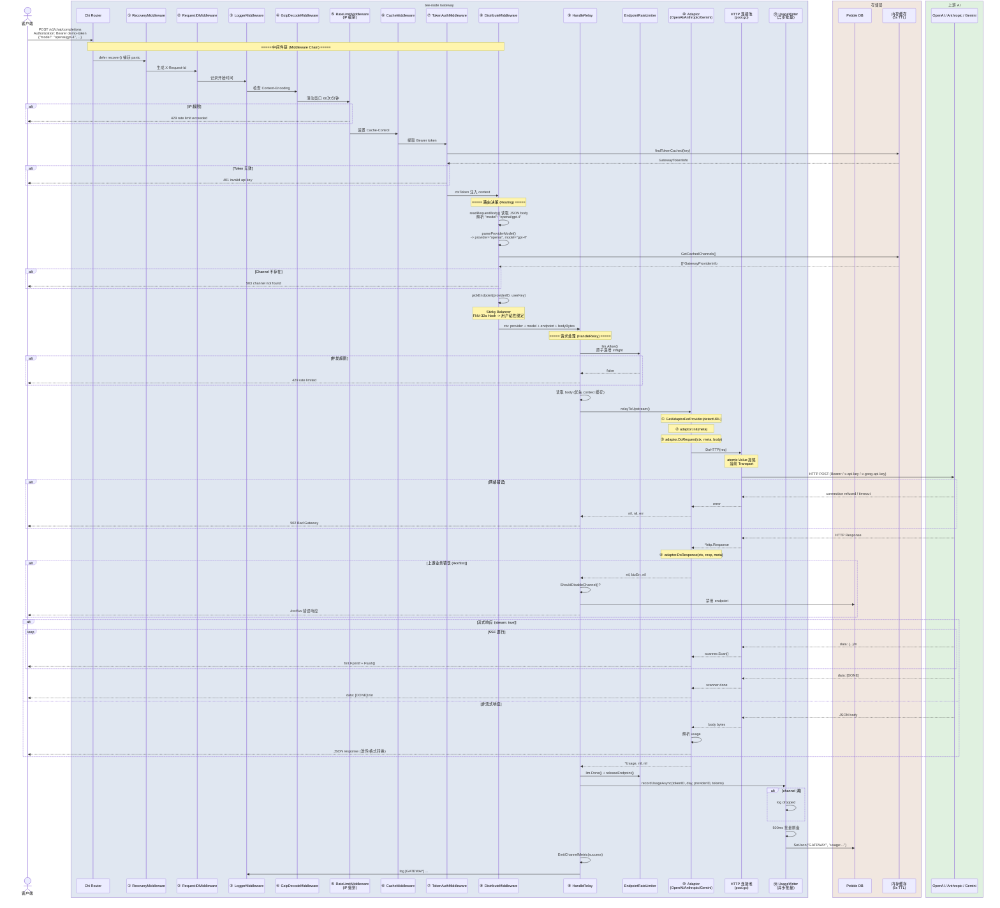
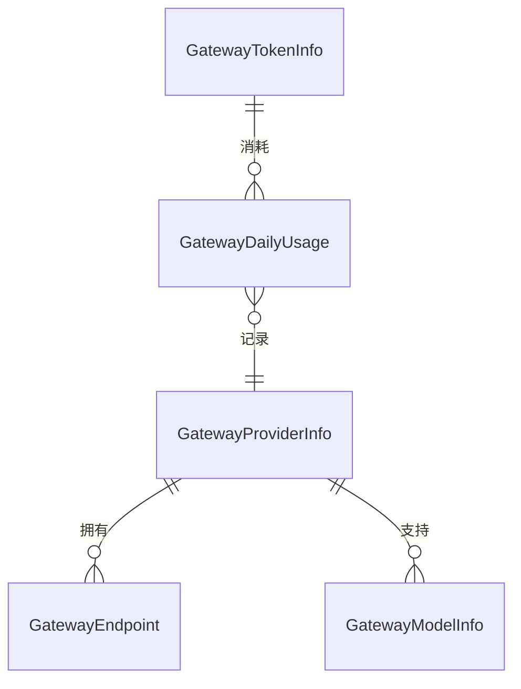

# AI 模型请求转发（Gateway Relay）逻辑文档

> 审查范围：`pkg/api/gateway/`、`pkg/services/gateway/relay/`、`pkg/model/gateway_*.go`
> 最后更新：2026-05-21

## 1. 架构概述

`tee-node` 中的 Gateway 模块是一个 **AI API 统一网关**，对外提供兼容 OpenAI SDK 的 REST API（`/v1/chat/completions` 等），对内将请求转发到不同的上游 AI 提供商（OpenAI、Anthropic、Gemini 等），同时完成认证、路由、协议转换、限流、计费、监控等功能。

### 1.1 泳道架构图（请求完整生命周期）



### 1.2 组件拓扑图

```mermaid
flowchart LR
    Client["客户端 (OpenAI SDK)"] -->|"Bearer API Key"| GW["Gateway REST API /v1/*"]

    subgraph Gateway["Gateway 网关层"]
        MW1["RecoveryMiddleware（Panic 恢复）"]
        MW2["RequestIDMiddleware（请求追踪）"]
        MW3["LoggerMiddleware（日志）"]
        MW4["GzipDecodeMiddleware（GZip 解压）"]
        MW5["RateLimitMiddleware（IP 级别限流）"]
        MW6["CacheMiddleware（缓存控制）"]
        MW7["TokenAuthMiddleware（API Key 鉴权）"]
        MW8["DistributeMiddleware（路由选择）"]
        Handler["HandleRelay（转发处理器）"]

        MW1 --> MW2 --> MW3 --> MW4 --> MW5 --> MW6 --> MW7 --> MW8 --> Handler
    end

    subgraph Adaptor["Adaptor 适配层"]
        OpenAI["OpenAIAdaptor（透传）"]
        Anthropic["AnthropicAdaptor（格式转换）"]
        Gemini["GeminiAdaptor（格式转换）"]
    end

    subgraph Upstream["上游 AI 服务"]
        OpenAI_SVC["api.openai.com"]
        Anthropic_SVC["api.anthropic.com"]
        Gemini_SVC["generativelanguage.googleapis.com"]
    end

    Handler --> Adaptor
    Adaptor --> Upstream
```



### 1.3 部署架构

```mermaid
flowchart TB
    subgraph K8s["Kubernetes 集群"]
        TEE["tee-node Pod\n(GraphQL + Gateway REST)"]
        Pebble["Pebble 嵌入式 DB"]
    end

    subgraph Blockchain["区块链"]
        Subnet["Subnet 合约\n(管理员)"]
        Token["Token 合约\n(积分)"]
    end

    subgraph Upstream["上游 AI 服务"]
        OAI["OpenAI API"]
        Anthro["Anthropic API"]
        Gem["Gemini API"]
    end

    Client["App 客户端"] -->| "Bearer demo-token" | TEE
    TEE --> Pebble
    TEE --> OAI
    TEE --> Anthro
    TEE --> Gem
    TEE -.->|"链上结算"| Subnet
    TEE -.->|"积分记录"| Token
```

## 2. 请求完整流转流程

```
客户端请求
  |
  v
① Panic 恢复 -> 捕获任何 panic，返回 500 而非崩溃
  |
  v
② 请求 ID -> 生成或透传 X-Request-Id，用于链路追踪
  |
  v
③ 日志记录 -> 记录 method、path、status、耗时、远程地址
  |
  v
④ GZip 解压 -> 如果 Content-Encoding: gzip，自动解压请求体
  |
  v
⑤ IP 级别限流 -> 60 次/分钟/客户端（滑动窗口）
  |
  v
⑥ 缓存控制 -> 设置 Cache-Control 响应头
  |
  v
⑦ API Key 鉴权 -> 从 Authorization: Bearer <key> 提取并验证 API Key
  |
  v
⑧ 路由分配 -> 解析 channel/model，选择服务商和端点
  |
  v
⑨ 端点级别限流 -> 控制单 endpoint 的并发和 RPM
  |
  v
⑩ 转发到上游 -> 通过 Adaptor 发送请求
  |
  v
⑪ 响应处理 -> 流式（SSE 透传）或非流式（返回 JSON）
  |
  v
⑫ 用量记录 -> 异步写入 tokens 使用量和积分消耗
  |
  v
⑬ 返回客户端
```

## 3. 中间件链条

### 3.1 RecoveryMiddleware
- **功能**：捕获 handler 中的 panic，打印堆栈，返回 500 错误
- **位置**：`pkg/api/gateway/middleware.go`

### 3.2 RequestIDMiddleware
- **功能**：读取/生成 `X-Request-Id` header（crypto/rand 随机），用于全链路请求追踪
- **位置**：`pkg/api/gateway/middleware.go`

### 3.3 LoggerMiddleware
- **功能**：记录每个请求的 method、path、status code、耗时、远程 IP
- **位置**：`pkg/api/gateway/middleware.go`

### 3.4 GzipDecodeMiddleware
- **功能**：如果请求 `Content-Encoding: gzip`，自动解压请求体
- **位置**：`pkg/api/gateway/middleware.go`

### 3.5 RateLimitMiddleware
- **功能**：IP 级别的滑动窗口限流（默认 60 次/分钟）
- **实现**：基于 `map[string][]time.Time` 的内存滑动窗口
- **位置**：`pkg/api/gateway/middleware.go`

### 3.6 CacheMiddleware
- **功能**：对根路径设置 `no-cache`，对其他路径设置 7 天缓存
- **位置**：`pkg/api/gateway/middleware.go`

### 3.7 TokenAuthMiddleware
- **功能**：从 `Authorization: Bearer <key>` 提取 API Key，在缓存中查找对应 Token，验证有效性
- **失败**：返回 401 `missing api key` 或 `invalid api key`
- **位置**：`pkg/api/gateway/auth_middleware.go`

### 3.8 DistributeMiddleware
- **功能**：核心路由中间件，决定将请求转发到哪个上游服务商的哪个端点
- **流程**：
  1. 提前读取 JSON body，解析模型名称（如 `openai/gpt-4` -> 服务商 `openai`，模型 `gpt-4`）
  2. 在缓存的 channel 列表中查找对应 provider
  3. 使用 **一致性 Hash（FNV-32a）** 选择 endpoint，实现用户粘性
  4. 将 provider、model、endpoint、bodyBytes 注入 context
- **位置**：`pkg/api/gateway/auth_middleware.go`

## 4. Channel / Provider 模型

### 4.1 核心概念

| 概念 | 类型 | 说明 |
|------|------|------|
| **Model** | `GatewayModelInfo` | AI 模型定义（如 `gpt-4`、`claude-3-sonnet`），包含积分定价 |
| **Provider（Channel）** | `GatewayProviderInfo` | 上游服务商（如 OpenAI、Anthropic），包含一组可用模型 |
| **Endpoint** | `GatewayEndpoint` | 服务商的 API 入口（URL + API Key），一个 Provider 可有多个 Endpoint |
| **Token** | `GatewayTokenInfo` | 用户 API Key，用于鉴权和计费 |
| **Balance** | `GatewayUserBalance` | 用户积分余额 |
| **DailyUsage** | `GatewayDailyUsage` | 按天统计的用量（token 数、积分消耗） |

### 4.2 数据关系



### 4.3 支持的上游服务商

| 服务商 | 默认 Base URL | Adaptor |
|--------|--------------|---------|
| OpenAI | `https://api.openai.com` | `OpenAIAdaptor`（透传） |
| Anthropic | `https://api.anthropic.com` | `AnthropicAdaptor`（格式转换） |
| Gemini | `https://generativelanguage.googleapis.com` | `GeminiAdaptor`（格式转换） |
| DeepSeek | `https://api.deepseek.com` | `OpenAIAdaptor`（兼容） |
| Groq | `https://api.groq.com/openai` | `OpenAIAdaptor`（兼容） |
| Mistral | `https://api.mistral.ai` | `OpenAIAdaptor`（兼容） |
| Cohere | `https://api.cohere.ai` | `OpenAIAdaptor`（兼容） |
| XAI | `https://api.x.ai` | `OpenAIAdaptor`（兼容） |
| Ollama | `http://localhost:11434` | `OpenAIAdaptor`（兼容） |

## 5. Adaptor 模式

### 5.1 接口

```go
type Adaptor interface {
    Init(meta *Meta)
    GetRequestURL(meta *Meta) (string, error)
    SetupRequestHeader(ctx *RelayContext, req *http.Request, meta *Meta) error
    DoRequest(ctx *RelayContext, meta *Meta, body io.Reader) (*http.Response, error)
    DoResponse(ctx *RelayContext, resp *http.Response, meta *Meta) (*Usage, *ErrorWithStatusCode)
    GetModelList() []string
    GetChannelName() string
}
```

### 5.2 OpenAIAdaptor
- 直接透传，认证方式 `Authorization: Bearer <apiKey>`
- 通过 `DoHTTP` 使用托管连接池

### 5.3 AnthropicAdaptor
- OpenAI 格式 <-> Anthropic Messages API 双向转换
- 认证方式 `x-api-key` + `anthropic-version: 2023-06-01`
- 通过 `DoHTTP` 使用托管连接池

### 5.4 GeminiAdaptor
- OpenAI 格式 <-> Gemini generateContent API 双向转换
- 认证方式 `x-goog-api-key`
- 自动追加安全设置（BLOCK_NONE）
- 通过 `DoHTTP` 使用托管连接池

## 6. 请求路由（Sticky Balancer）

- 用户通过 `userKey` 做 FNV-32a Hash 分配 endpoint
- 同一用户永久绑定同一 endpoint（直到 endpoint 故障）
- 最大化上游 server-side cache 命中，降低成本
- Double-checked locking 防止并发竞争

## 7. HTTP 连接池 & Auto Scaler

| 参数 | 默认值 | 说明 |
|------|--------|------|
| MaxConnsPerHost | 500 | 单 Host 最大连接数 |
| MaxIdleConns | 2000 | 总空闲连接数 |
| DialTimeout | 10s | 建连超时 |
| RequestTimeout | 180s | 请求总超时 |

Auto Scaler 每 10s tick：
- 利用率 > 70% -> 扩容（1 tick 生效，冷却 2 分钟）
- 利用率 < 15% 持续 10 分钟 -> 缩容

## 8. 速率限制

| 层级 | 类型 | 限制 |
|------|------|------|
| IP 级别 | 滑动窗口 | 60 次/分钟 |
| Endpoint (OpenAI) | 并发 | 50 |
| Endpoint (Anthropic) | 并发 | 20 |
| Endpoint (Gemini) | 并发 | 100 |

## 9. 用量追踪 & 计费

| 模型 | 积分/1K tokens |
|------|:---:|
| gpt-4 | 30 |
| gpt-4o | 5 |
| gpt-4o-mini | 1 |
| gpt-3.5-turbo | 3 |
| claude-3-opus | 25 |
| claude-3-sonnet | 10 |
| gemini-1.5-pro | 5 |
| gemini-1.5-flash | 1 |

异步写入：channel buffer 4096，500ms 批量刷盘。满时记录日志。

## 10. 健康监控

- Channel 成功率 < 30% -> 自动禁用
- Endpoint 返回 401 / insufficient_quota / invalid_api_key -> 自动禁用

## 11. 项目结构

```
tee-node/
├── pkg/
│   ├── api/gateway/
│   │   ├── relay_handler.go      ← 路由注册 + 请求处理入口
│   │   ├── middleware.go          ← 8 个中间件 + 健康监控
│   │   ├── auth_middleware.go     ← 鉴权 + 路由 + Balancer
│   │   ├── rate_limit.go         ← Endpoint 并发限流
│   │   ├── auto_scaler.go        ← 连接池自动伸缩
│   │   ├── cache.go              ← 内存缓存 (5s TTL)
│   │   ├── optimizer.go          ← 异步用量写入
│   │   └── seed.go               ← 种子数据初始化
│   ├── services/
│   │   ├── auth/                  ← JWT / Email / OAuth / OTP
│   │   ├── wallet/                ← 钱包派生 / 加密 / 签名
│   │   └── gateway/relay/
│   │       ├── adaptor.go         ← Adaptor 接口 + OpenAIAdaptor
│   │       ├── anthropic.go       ← Anthropic 适配器
│   │       ├── gemini.go          ← Gemini 适配器
│   │       ├── helper.go          ← Provider 检测 / SSE 写入
│   │       ├── context.go         ← RelayContext
│   │       ├── meta.go            ← Meta 上下文
│   │       └── pool.go            ← HTTP 连接池
│   └── model/
│       ├── gateway_store.go       ← 数据模型 + Pebble CRUD
│       └── gateway_endpoint.go    ← Endpoint + Sticky Balancer
├── config/                        ← 链配置
├── graph/                         ← GraphQL 层
└── main.go                        ← 入口
```

---

# 附录 A：Bug 报告与修复记录

## A.1 Bug 总览

| # | 严重度 | 标题 | 涉及文件 | 状态 |
|---|:---:|------|------|:---:|
| B1 | 🔴 | 路由模型名从 query string 取而非 JSON body | `auth_middleware.go` | ✅ |
| B2 | 🔴 | `GetAdaptorForProvider` 缺少 `"gemini"` case | `helper.go` | ✅ |
| B3 | 🔴 | Anthropic/Gemini 绕过 HTTP 连接池 | `anthropic.go` `gemini.go` | ✅ |
| B4 | 🟠 | 错误路径双写 ResponseWriter | `relay_handler.go` | ✅ |
| B5 | 🟠 | `EmitChannelMetric` 无并发保护 data race | `middleware.go` | ✅ |
| B6 | 🟠 | `pickEndpoint` Balancer 替换竞争 inflight 泄漏 | `auth_middleware.go` | ✅ |
| B7 | 🟠 | `getEndpointLimiter` TOCTOU 重复创建 | `rate_limit.go` | ✅ |
| B8 | 🟠 | `Allow()` 读取 `maxConc` 无同步 | `rate_limit.go` | ✅ |
| B10 | 🟡 | `recordUsageAsync` 硬编码 tokenID=0 | `relay_handler.go` | ✅ |
| B11 | 🟡 | `readRequestBody` 错误被静默忽略 | `relay_handler.go` | ✅ |
| B12 | 🟡 | RequestID 随机部分永远为 `00000000` | `middleware.go` | ✅ |
| B13 | 🟢 | 用量 channel 满时静默丢弃 | `optimizer.go` | ✅ |
| B14 | 🟢 | `HandleListModels` nil 检查永不成立 | `relay_handler.go` | ✅ |

## A.2 已修复详情

### B1 路由模型名从 query string 取而非请求体
- **修复**：`DistributeMiddleware` 提前读取 body 解析 model，body 通过 context 传递避免重复读取

### B2 GetAdaptorForProvider 缺少 gemini case
- **修复**：添加 `case "gemini": return &GeminiAdaptor{}`

### B3 Anthropic/Gemini 绕过 HTTP 连接池
- **修复**：`http.DefaultClient.Do(req)` -> `DoHTTP(req)`，统一使用托管连接池

### B4 错误路径双写 ResponseWriter
- **修复**：`relayToUpstream` 签名改为三返回值，业务错误由 `HandleRelay` 统一写入

### B5 EmitChannelMetric 无并发保护
- **修复**：添加 `channelMetricsMu sync.Mutex`

### B6 pickEndpoint Balancer 替换竞争
- **修复**：标准 double-checked locking 模式

### B7 getEndpointLimiter TOCTOU
- **修复**：全程使用 `Lock()` 替代 `RLock()`+`Lock()`

### B8 Allow() 读取 maxConc 无同步
- **修复**：使用 `atomic.LoadInt64` / `atomic.StoreInt64`

### B10 recordUsageAsync 硬编码 tokenID=0
- **修复**：从 context 获取实际 token.ID

### B11 readRequestBody 错误被忽略
- **修复**：添加错误检查和 400 返回

### B12 RequestID 随机部分永远为 00000000
- **修复**：使用 `crypto/rand.Read` 填充随机字节

### B13 用量 channel 满时静默丢弃
- **修复**：default 分支添加 `log.Printf`

### B14 HandleListModels nil 检查永不成立
- **修复**：移除无效检查

## A.3 目录结构迁移

**变更前**：
```
tee-node/
├── pkg/api/gateway/
├── services/
│   ├── auth/
│   ├── gateway/
│   │   ├── adaptor/ (空)
│   │   └── relay/
│   ├── recovery/ (空)
│   └── wallet/
```

**变更后**：
```
tee-node/
└── pkg/
    ├── api/gateway/
    └── services/
        ├── auth/
        ├── gateway/relay/
        └── wallet/
```

顶层 `services/` 目录已移除，所有服务统一在 `pkg/services/` 下。

---

*文档生成/更新：2026-05-21*
*基于代码版本：`tee-node` 项目当前仓库状态*
