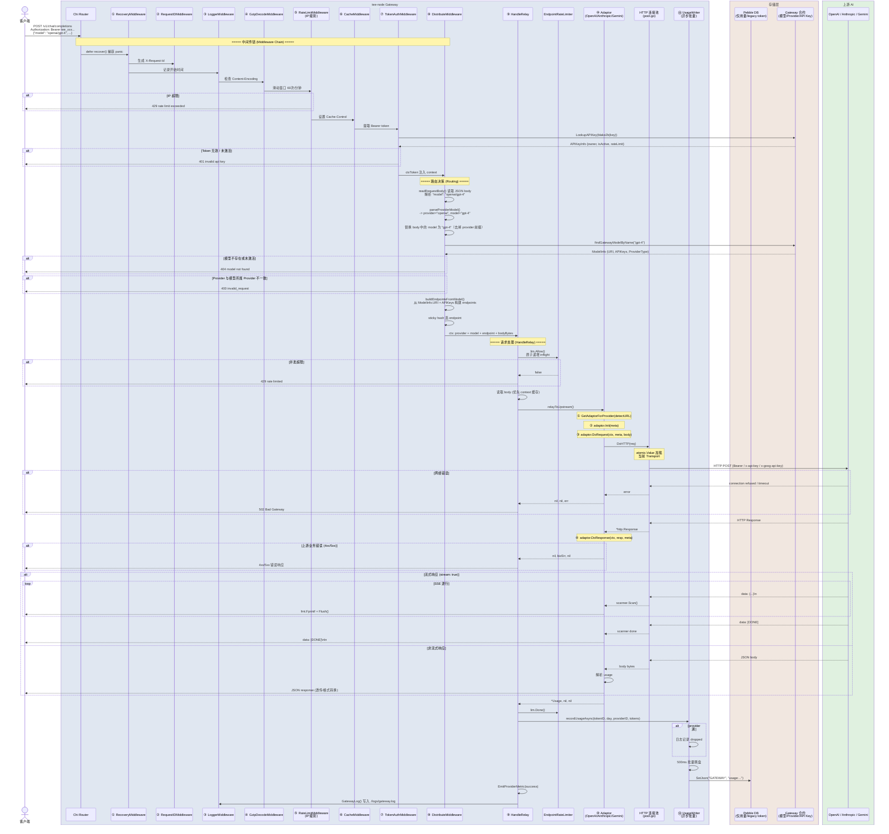
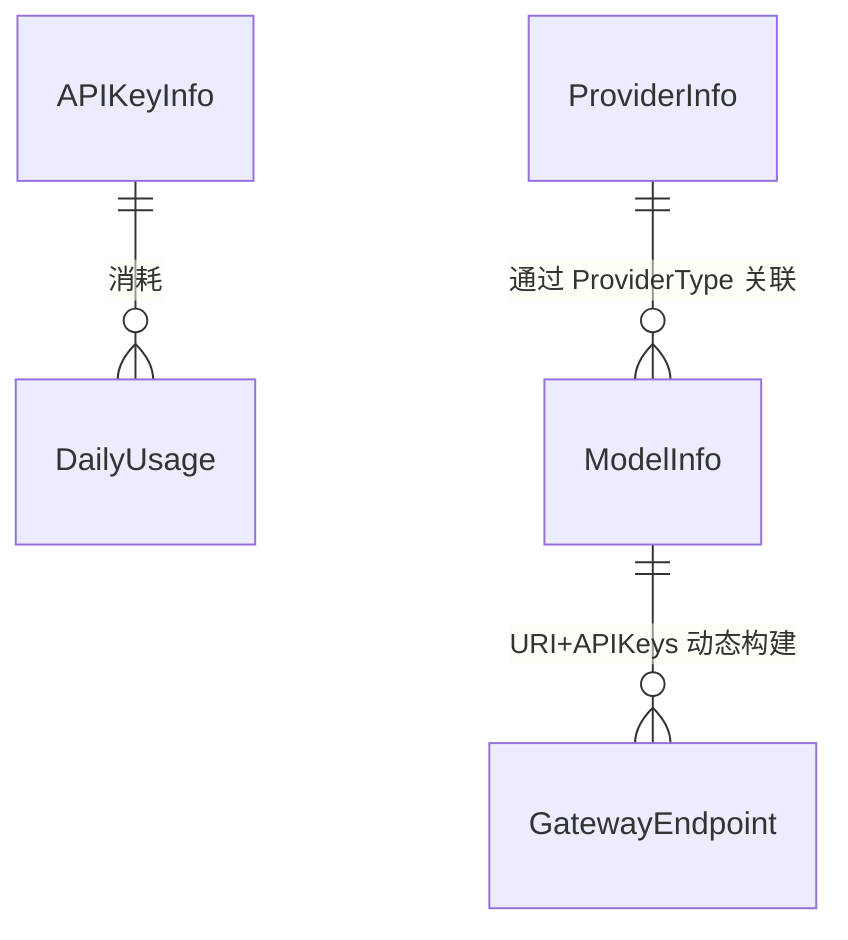

# AI 模型请求转发（Gateway Relay）逻辑文档

> 审查范围：`pkg/api/gateway/`、`pkg/services/gateway/relay/`、`pkg/model/gateway_*.go`
> 最后更新：2026-05-21

## 1. 架构概述

`tee-node` 中的 Gateway 模块是一个 **AI API 统一网关**，对外提供兼容 OpenAI SDK 的 REST API（`/v1/chat/completions` 等），对内将请求转发到不同的上游 AI 提供商（OpenAI、Anthropic、Gemini 等），同时完成认证、路由、协议转换、限流、计费、监控等功能。

**核心变更（2026-05-21）**：
- 认证统一为单一 API Key（`Authorization: Bearer <key>`），JWT 和 Legacy Polkadot 鉴权已移除
- 所有 Gateway 数据（模型、Provider、API Key）**必须从链上合约查询**，本地 PebbleDB seed 数据已废弃
- 请求模型必须在合约中存在且活跃，否则返回 404
- Gateway 日志统一写入 `./logs/gateway.log`，不再输出到终端

### 1.1 泳道架构图（请求完整生命周期）



### 1.2 组件拓扑图

```mermaid
flowchart LR
    Client["客户端 (OpenAI SDK)"] -->|"Bearer API Key"| GW["Gateway REST API /v1/*"]

    subgraph Gateway["Gateway 网关层"]
        MW1["RecoveryMiddleware（Panic 恢复）"]
        MW2["RequestIDMiddleware（请求追踪）"]
        MW3["LoggerMiddleware（日志）"]
        MW4["GzipDecodeMiddleware（GZip 解压）"]
        MW5["RateLimitMiddleware（IP 级别限流）"]
        MW6["CacheMiddleware（缓存控制）"]
        MW7["TokenAuthMiddleware（API Key 鉴权）"]
        MW8["DistributeMiddleware（合约路由）"]
        Handler["HandleRelay（转发处理器）"]

        MW1 --> MW2 --> MW3 --> MW4 --> MW5 --> MW6 --> MW7 --> MW8 --> Handler
    end

    subgraph Contract["链上合约"]
        Model["ModelInfo（URI/APIKeys）"]
        Prov["ProviderInfo"]
        Key["APIKeyInfo"]
    end

    subgraph Adaptor["Adaptor 适配层"]
        OpenAI["OpenAIAdaptor（透传）"]
        Anthropic["AnthropicAdaptor（格式转换）"]
        Gemini["GeminiAdaptor（格式转换）"]
    end

    subgraph Upstream["上游 AI 服务"]
        OpenAI_SVC["api.openai.com"]
        Anthropic_SVC["api.anthropic.com"]
        Gemini_SVC["generativelanguage.googleapis.com"]
    end

    MW7 --> Contract
    MW8 --> Contract
    Handler --> Adaptor
    Adaptor --> Upstream
```



### 1.3 部署架构

```mermaid
flowchart TB
    subgraph K8s["Kubernetes 集群"]
        TEE["tee-node Pod\n(GraphQL + Gateway REST)"]
        Pebble["Pebble 嵌入式 DB\n(用量记录/legacy token)"]
        Logs["./logs/gateway.log"]
    end

    subgraph Blockchain["区块链"]
        Gateway["Gateway 合约\n(模型/Provider/API Key)"]
    end

    subgraph Upstream["上游 AI 服务"]
        OAI["OpenAI API"]
        Anthro["Anthropic API"]
        Gem["Gemini API"]
    end

    Client["App 客户端"] -->| "Bearer tee_xxx..." | TEE
    TEE --> Pebble
    TEE --> Logs
    TEE --> Gateway
    TEE --> OAI
    TEE --> Anthro
    TEE --> Gem
```

## 2. 请求完整流转流程

```
客户端请求
  |
  v
① Panic 恢复 -> 捕获任何 panic，返回 500 而非崩溃
  |
  v
② 请求 ID -> 生成或透传 X-Request-Id，用于链路追踪
  |
  v
③ 日志记录 -> 记录 method、path、status、耗时、远程地址（写入 gateway.log）
  |
  v
④ GZip 解压 -> 如果 Content-Encoding: gzip，自动解压请求体
  |
  v
⑤ IP 级别限流 -> 60 次/分钟/客户端（滑动窗口）
  |
  v
⑥ 缓存控制 -> 设置 Cache-Control 响应头
  |
  v
⑦ API Key 鉴权 -> 从 Authorization: Bearer <key> 提取，合约 LookupAPIKey 验证
  |
  v
⑧ 路由分配 -> 解析 model，合约查询验证，从 ModelInfo 构建 endpoints，sticky 选端点
  |
  v
⑨ 端点级别限流 -> 控制单 endpoint 的并发和 RPM
  |
  v
⑩ 转发到上游 -> 通过 Adaptor 发送请求（URI 去重防止 /v1/v1）
  |
  v
⑪ 响应处理 -> 流式（SSE 透传）或非流式（返回 JSON）
  |
  v
⑫ 用量记录 -> 异步写入 tokens 使用量和积分消耗
  |
  v
⑬ 返回客户端
```

## 3. 中间件链条

### 3.1 RecoveryMiddleware
- **功能**：捕获 handler 中的 panic，打印堆栈，返回 500 错误
- **位置**：`pkg/api/gateway/middleware.go`
- **日志**：写入 `./logs/gateway.log`

### 3.2 RequestIDMiddleware
- **功能**：读取/生成 `X-Request-Id` header（crypto/rand 随机），用于全链路请求追踪
- **位置**：`pkg/api/gateway/middleware.go`

### 3.3 LoggerMiddleware
- **功能**：记录每个请求的 method、path、status code、耗时、远程 IP
- **位置**：`pkg/api/gateway/middleware.go`
- **输出**：`GatewayLog()` → `./logs/gateway.log`

### 3.4 GzipDecodeMiddleware
- **功能**：如果请求 `Content-Encoding: gzip`，自动解压请求体
- **位置**：`pkg/api/gateway/middleware.go`

### 3.5 RateLimitMiddleware
- **功能**：IP 级别的滑动窗口限流（默认 60 次/分钟）
- **实现**：基于 `map[string][]time.Time` 的内存滑动窗口
- **位置**：`pkg/api/gateway/middleware.go`

### 3.6 CacheMiddleware
- **功能**：对根路径设置 `no-cache`，对其他路径设置 7 天缓存
- **位置**：`pkg/api/gateway/middleware.go`

### 3.7 TokenAuthMiddleware
- **功能**：从 `Authorization: Bearer <key>` 提取 API Key，**链上合约** `LookupAPIKey(hash)` 验证有效性
- **失败**：返回 401 `missing api key` 或 `invalid api key`
- **位置**：`pkg/api/gateway/auth_middleware.go`
- **注意**：不再使用本地 PebbleDB token 缓存做首要验证

### 3.8 DistributeMiddleware
- **功能**：核心路由中间件，基于**链上合约数据**决定请求转发到哪个上游端点
- **流程**：
  1. 提前读取 JSON body，解析模型名称（如 `test/MiniMax-M2.7` → provider `test`，模型 `MiniMax-M2.7`）
  2. **替换 body 中的 model 字段**为纯模型名（去掉 provider 前缀），不改变其他字段
  3. **从合约查询模型** `findGatewayModelByName(actualModel)`，验证存在且活跃
  4. 验证请求的 Provider 与模型所属 Provider 一致
  5. 从合约 `ModelInfo.URI` + `ModelInfo.APIKeys` **动态构建 endpoints**
  6. 使用 **一致性 Hash（FNV-32a）** 选择 endpoint，实现用户粘性
  7. 将 provider、model、endpoint、bodyBytes 注入 context
- **URI 去重**：如果 `BaseURL` 末尾路径段与请求路径开头重复（如 `https://api.minimaxi.com/v1` + `/v1/chat/completions`），自动去重为 `https://api.minimaxi.com/v1/chat/completions`
- **位置**：`pkg/api/gateway/auth_middleware.go`

## 4. Provider / Provider 模型

### 4.1 核心概念

| 概念 | 类型 | 说明 |
|------|------|------|
| **Model** | `cgateway.ModelInfo`（链上） | AI 模型定义，包含 `URI`、`APIKeys`、`ProviderType`、`PointsPer1K` |
| **Provider** | `cgateway.ProviderInfo`（链上） | 上游服务商，由 `ProviderType` 映射为名称 |
| **Endpoint** | `GatewayEndpoint`（内存） | 从合约 `ModelInfo.URI` + `APIKeys` 动态构建 |
| **Token** | `GatewayTokenInfo` | 用户 API Key，用于鉴权和计费 |
| **DailyUsage** | `GatewayDailyUsage` | 按天统计的用量（token 数、积分消耗），写入 PebbleDB |

### 4.2 数据关系



### 4.3 支持的上游服务商

| 服务商 | ProviderType | 默认 Base URL | Adaptor |
|--------|:---:|:--------------|---------|
| OpenAI | 1 | `https://api.openai.com` | `OpenAIAdaptor`（透传） |
| Anthropic | 2 | `https://api.anthropic.com` | `AnthropicAdaptor`（格式转换） |
| Gemini | 3 | `https://generativelanguage.googleapis.com` | `GeminiAdaptor`（格式转换） |
| 其他（DeepSeek/Groq/Mistral/Cohere/XAI/Ollama/MiniMax 等） | 自定义 URI | 合约 `ModelInfo.URI` | `OpenAIAdaptor`（兼容） |

**注意**：所有服务商的 URI 和 API Keys 均从链上合约 `ModelInfo` 读取，不再使用本地 seed 数据。

## 5. Adaptor 模式

### 5.1 接口

```go
type Adaptor interface {
    Init(meta *Meta)
    GetRequestURL(meta *Meta) (string, error)
    SetupRequestHeader(ctx *RelayContext, req *http.Request, meta *Meta) error
    DoRequest(ctx *RelayContext, meta *Meta, requestBody io.Reader) (*http.Response, error)
    DoResponse(ctx *RelayContext, resp *http.Response, meta *Meta) (usage *Usage, err *ErrorWithStatusCode)
    GetModelList() []string
    GetProviderName() string
}
```

### 5.2 OpenAIAdaptor
- 直接透传，认证方式 `Authorization: Bearer <apiKey>`
- **URI 去重**：`GetRequestURL()` 自动检测并去除 BaseURL 与请求路径的重复路径段
- 通过 `DoHTTP` 使用托管连接池

### 5.3 AnthropicAdaptor
- OpenAI 格式 <-> Anthropic Messages API 双向转换
- 认证方式 `x-api-key` + `anthropic-version: 2023-06-01`
- 通过 `DoHTTP` 使用托管连接池

### 5.4 GeminiAdaptor
- OpenAI 格式 <-> Gemini generateContent API 双向转换
- 认证方式 `x-goog-api-key`
- 自动追加安全设置（BLOCK_NONE）
- 通过 `DoHTTP` 使用托管连接池

## 6. 请求路由（Sticky Balancer）

- 用户通过 `userKey` 做 FNV-32a Hash 分配 endpoint
- 同一用户永久绑定同一 endpoint（直到 endpoint 故障）
- 最大化上游 server-side cache 命中，降低成本
- Endpoints 从合约 `ModelInfo.APIKeys` 动态构建，而非 PebbleDB

## 7. HTTP 连接池 & Auto Scaler

| 参数 | 默认值 | 说明 |
|------|--------|------|
| MaxConnsPerHost | 500 | 单 Host 最大连接数 |
| MaxIdleConns | 2000 | 总空闲连接数 |
| DialTimeout | 10s | 建连超时 |
| RequestTimeout | 180s | 请求总超时 |

Auto Scaler 每 10s tick：
- 利用率 > 70% -> 扩容（1 tick 生效，冷却 2 分钟）
- 利用率 < 15% 持续 10 分钟 -> 缩容

## 8. 速率限制

| 层级 | 类型 | 限制 |
|------|------|------|
| IP 级别 | 滑动窗口 | 60 次/分钟 |
| Endpoint (OpenAI) | 并发 | 50 |
| Endpoint (Anthropic) | 并发 | 20 |
| Endpoint (Gemini) | 并发 | 100 |

## 9. 用量追踪 & 计费

计费公式（合约层）：
```
cost = (tokensUsed + 999) / 1000 * model.PointsPer1K + model.PromptPricing
if cost < 1 { cost = 1 }
```

异步写入：
- `recordUsageAsync()` 通过 provider（buffer 4096）发送到后台 goroutine
- 每 **500ms** 批量聚合写入 PebbleDB
- 聚合 key：`usage:{day}_{tokenID}`
- 满时记录日志到 `./logs/gateway.log`

## 10. 健康监控

- Provider 成功率 < 30% -> 记录日志告警（不再自动禁用本地 DB，Provider 状态由合约管理）
- Endpoint 返回 401 / insufficient_quota / invalid_api_key -> 记录日志
- 所有监控日志写入 `./logs/gateway.log`

## 11. 日志系统

Gateway 模块所有日志统一通过 `GatewayLog()` 输出到 `./logs/gateway.log`：

| 日志类型 | 前缀 | 说明 |
|---------|------|------|
| 请求日志 | `[HTTP]` | method、path、status、耗时、IP |
| 鉴权日志 | `[AUTH]` | token 验证结果 |
| 监控日志 | `[MONITOR]` | provider 成功率、上游错误 |
| 用量日志 | `[USAGE]` | dropped record 告警 |
| 扩容日志 | `[SCALER]` | 连接池扩缩容 |
| 合约日志 | `[GATEWAY]` | 合约查询结果 |
| 初始化日志 | `[OPT]` | 后台服务启动 |

## 12. 项目结构

```
tee-node/
├── pkg/
│   ├── api/gateway/
│   │   ├── relay_handler.go      ← 路由注册 + 请求处理入口
│   │   ├── middleware.go          ← 8 个中间件 + 健康监控
│   │   ├── auth_middleware.go     ← 鉴权 + 合约路由 + Balancer
│   │   ├── rate_limit.go         ← Endpoint 并发限流
│   │   ├── auto_scaler.go        ← 连接池自动伸缩
│   │   ├── cache.go              ← Token 缓存 (legacy fallback)
│   │   ├── optimizer.go          ← 异步用量写入
│   │   ├── contract.go           ← 合约查询桥接 + 模型缓存
│   │   ├── logger.go             ← Gateway 专用日志文件
│   │   └── seed.go               ← ~~已删除~~
│   ├── services/
│   │   ├── auth/                  ← JWT / Email / OAuth / OTP
│   │   ├── wallet/                ← 钱包派生 / 加密 / 签名
│   │   └── gateway/relay/
│   │       ├── adaptor.go         ← Adaptor 接口
│   │       ├── adaptor_openai.go  ← OpenAI 适配器（含 URI 去重）
│   │       ├── adaptor_anthropic.go ← Anthropic 适配器
│   │       ├── adaptor_gemini.go  ← Gemini 适配器
│   │       ├── helper.go          ← Provider 检测 / SSE 写入
│   │       ├── context.go         ← RelayContext
│   │       ├── meta.go            ← Meta 上下文
│   │       └── pool.go            ← HTTP 连接池
│   └── model/
│       ├── gateway_store.go       ← 数据模型（已删除 PebbleDB CRUD）
│       └── gateway_endpoint.go    ← Endpoint + Sticky Balancer
├── tee-chain/contracts/gateway/   ← 链上 Gateway 合约
│   ├── gateway.go                 ← 合约入口
│   ├── model.go                   ← 模型注册/查询
│   ├── provider.go                ← Provider 注册/查询
│   └── types.go                   ← ModelInfo/ProviderInfo/APIKeyInfo
└── docs/
    ├── ai-gateway-design.md       ← 本文档
    ├── api-key-design.md          ← API Key 设计
    └── unified-auth-design.md     ← 统一鉴权设计
```

## 13. 认证方式

### 13.1 REST Gateway
```
Authorization: Bearer tee_<64 hex chars>
```
TEE 侧 `blake2b.Sum256(apiKey)` → `GatewayLookupAPIKey(hash)` → 验证 `isActive`

### 13.2 GraphQL
```
Authorization: Bearer tee_<64 hex chars>
```
同一套 API Key 体系，不再支持 JWT 或 Legacy Polkadot 签名鉴权。

---

# 附录 A：重大变更记录

## 2026-05-21 统一鉴权 + 合约化

### 变更 1：统一鉴权为单一 API Key
- **移除**：JWT 鉴权、Legacy Polkadot 签名鉴权
- **保留**：`Authorization: Bearer <apiKey>` 作为唯一接口鉴权方式
- **影响文件**：`graph/auth.go`, `graph/auth_helpers.go`, `pkg/api/gateway/auth_middleware.go`

### 变更 2：Gateway 数据从合约读取
- **移除**：`seed.go`（本地 seed 数据初始化）、`InitSeedData()` 调用
- **移除**：`findProviderCached()`、`pickEndpoint()` 等基于 PebbleDB 的旧路由逻辑
- **新增**：`contract.go` 合约查询桥接，`findGatewayModelByName()` 从合约查模型
- **新增**：`buildEndpointsFromModel()` 从合约 `ModelInfo.URI` + `APIKeys` 动态构建 endpoints
- **模型验证**：`DistributeMiddleware` 先查询合约验证模型存在，404 拦截不存在模型

### 变更 3：URI 去重
- **修复**：`OpenAIAdaptor.GetRequestURL()` 自动去除 BaseURL 与请求路径的重复路径段
- **场景**：`https://api.minimaxi.com/v1` + `/v1/chat/completions` → `https://api.minimaxi.com/v1/chat/completions`

### 变更 4：Body model 字段替换
- **功能**：支持 `"provider/model"` 格式请求，自动替换 body 中的 `"model"` 为纯模型名
- **实现**：`json.Unmarshal` → `map[string]interface{}` → 替换 → `json.Marshal`

### 变更 5：独立日志文件
- **新增**：`logger.go`，`GatewayLog()` 返回写入 `./logs/gateway.log` 的 logger
- **替换**：所有 `log.Printf("[GATEWAY]/[AUTH]/[MONITOR]/[USAGE]/[SCALER]...")` 改为 `GatewayLog().Printf()`

### 变更 6：清理废弃代码
- **删除**：`seed.go`
- **删除**：`pkg/model/gateway_store.go` 中未使用的 PebbleDB CRUD（SetGatewayModel/GetGatewayModel 等）
- **删除**：`pkg/model/gateway_endpoint.go` 中基于 PebbleDB 的 `ListProviderEndpoints`
- **保留**：`GetGatewayToken/SetGatewayToken/FindGatewayTokenByKey` 作为 legacy token fallback

---

*文档生成/更新：2026-05-21*
*基于代码版本：`tee-node` 项目当前仓库状态*
